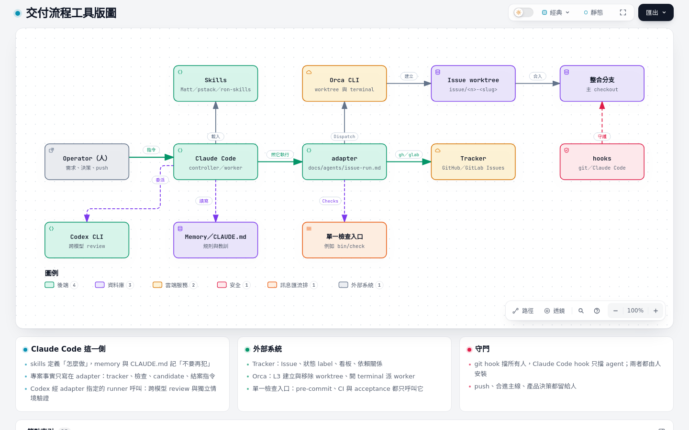

# 01 工具與角色

流程裡有五種角色，靠五類工具串起來。先記住一條邊界：**agent 做到本機 candidate commit 為止；push、合進共用分支、產品決策，以及對共用環境（資料庫、正式站）的操作，都留給人。** 到 L3 這條邊界也只放寬到「adapter 明文允許的 push、開 PR／MR 與合進主線」。

互動版：[diagrams/01-tooling.html](diagrams/01-tooling.html)（來源 [`diagrams/src/01-tooling.architecture.json`](diagrams/src/01-tooling.architecture.json)）

## 角色

| 角色 | 在哪裡跑 | 負責 | 不做 | 從哪一級出現 |
| --- | --- | --- | --- | --- |
| **Operator**（人） | 自己的終端與對話 | 提需求、回答釐清問題、產品決策、對共用環境執行 artifact 並讀回、push、合併 PR／MR（L3 的 adapter 交給 coordinator 時除外） | 不手動把分支合進整合分支（L2 起一律經入口腳本） | L1 |
| **controller** | 輸入 `/issue-run <n>` 或 `/issue-run --pool` 的那個 session | 單張或一組 Issue 的 Gate → Graph → Claim → Build → Candidate → Report；做到 candidate 停下來報告（adapter 允許時自己 push、開 PR／MR、合進主線並結案） | adapter 沒有允許時不 push、不合進共用分支、不結案 | L1 |
| **subagent**（Claude） | controller 以 Agent 工具派出 | 多張 ticket 時的 implementer（`implement-spec`）、`code-review` 的 Standards／Spec 兩軸審查 | 不跨出指派的 worktree；結論交回 controller 判讀 | L1 |
| **coordinator** | 主 checkout 的 `/loop /issue-pilot` | 對帳、挑單、組批次、派 worker、整批回歸、合入整合分支、交出 push 指令（adapter 允許時自己 push、開 PR／MR、合進主線）、結案；決定記在 `.scratch/pilot/decisions.md` | 不寫產品程式碼；同一個 repo 同時只有一個 coordinator | L3 |
| **worker** | 每張 Issue 自己的 worktree，跑 `/issue-run <n> --worker <checkpoint>` | 單張 Issue 的實作、本單檢查、review，做到 candidate，最後一行印 `DONE <n> <SHA>` 或 `STOP <n> <原因>` | 不問人（產品問題留言到 Issue 後 `STOP`）；不合入、不 push、不結案 | L3 |
| **Codex** | 經 adapter 指定的 runner 腳本呼叫 | 跨模型 review、高風險 Issue 的獨立情境驗證、兩輪 review 後仍有爭議的 finding 的第二意見 | 不 commit；結果由 controller 判讀 | L3（L1／L2 可選） |

controller 與 worker 是同一個 `/issue-run` skill 的兩種模式：沒有 coordinator 時你自己打 `/issue-run <n>`，它就是 controller；在 L3 由 coordinator 派出時加 `--worker`，它就只做到 candidate、用最後一行回報。`--pool` 也是 controller：它在同一個 session 從池子依序認領、一次跑一張，不開分頁、不並行，不需要 Pilot 段，只要 repo 有 `scripts/issue-pool.mjs`。

## 工具

| 工具 | 角色 | 邊界 |
| --- | --- | --- |
| **Claude Code** | 跑 skills、呼叫 scripts、讀寫 memory | 權限由 repo 的 `.claude/settings.json` 決定，只有人能改（見 [04 權限規則](04-level2.md#權限規則)） |
| **skills**（`~/.claude/skills/`） | 定義「怎麼做」 | 使用者層由 ron-skills 的 `bin/sync-skills` 連結 Matt、pstack 與 ron-skills 三層；專案層放在 repo 的 `.claude/skills/`。上游原始檔不改，個人調整用 `overlays/*.patch` |
| **adapter**（`docs/agents/issue-run.md`） | 定義「在這個 repo 用哪些指令」 | 專案事實只寫在這裡；skill 本身不含任何專案路徑。範本是 [`ADAPTER.md`](../../skills/engineering/issue-run/ADAPTER.md) |
| **hooks** | git hooks（pre-commit、pre-push）與 Claude Code hooks（`PreToolUse` 等）把規則變成擋得住的檢查 | git hook 擋所有人，Claude Code hook 只擋 agent；兩者都要由人安裝 |
| **tracker** | Issue、狀態 label、看板、依賴關係 | GitHub 用 `gh`，GitLab 用 `glab`；讀寫指令寫在 `docs/agents/issue-tracker.md` |
| **Orca** | 建立與移除 worktree、開 terminal 派 worker、交棒 | 可用性看環境變數 `ORCA_CLI_COMMAND`，不要用 `which orca`（那是 GNOME 螢幕閱讀器）。L1／L2 可不用；L3 的派工與監看靠它 |

## 支援平台

正本、測試與 `bin/` 在下面支援的三種平台都要能通過檢查入口。`/setup-workflow` 的環境站會偵測這台機器的平台，並問團隊還有誰用哪些平台，記進 adapter 的 `## Platforms`。

| 平台 | 支援 | 說明 |
| --- | --- | --- |
| WSL2 | 支援 | Windows 上的使用方式。Orca 從 WSL 呼叫時有幾個專屬的坑與 workaround，見 [08 常見坑](08-pitfalls.md#wsl) |
| macOS | 支援 | Orca 指令是 Orca.app 內 `orca` 的絕對路徑，設在 `ORCA_CLI_COMMAND` |
| Linux | 支援 | 一般發行版；`orca` 這個名稱可能是 GNOME 螢幕閱讀器，Orca 可用與否只看 `ORCA_CLI_COMMAND` |
| 原生 Windows | 不支援 | 環境站在這裡停下、不寫檔，提示改用 WSL2 |

## 三層 skill 怎麼疊

| 層 | 來源 | 內容 | 誰改 |
| --- | --- | --- | --- |
| Matt 原版 | `mattpocock/skills` 的 fork | 工程方法：`tdd`、`code-review`、`implement`、`implement-spec`、`triage`、`retro`… | 只同步上游 |
| pstack 原版 | `backnotprop/pstack` | 編排原則：`poteto-mode` 的 Autopilot playbook、`principle-*` | 只同步上游 |
| ron-skills | 本 repo | `issue-run`、`issue-pilot`、`retro-collect` 編排，以及對上兩層的 overlay | 自己 |
| 專案 adapter | 各 repo 的 `docs/agents/issue-run.md` | tracker、檢查、candidate、結案指令 | 各專案 |

Matt 的方法和 adapter 說法不同時，以 adapter 為準；`/issue-run` 會在報告裡列出這次用到的每一條覆寫。

## 常見的線

| 線 | 實際動作 |
| --- | --- |
| Operator → Claude Code | `/triage <n>`、`/issue-run <n>`、`/loop /issue-pilot`、回答 gate |
| Claude Code → tracker | adapter 的 Tracker 段指令（`gh issue …`／`glab issue …`） |
| Claude Code → 檢查 | adapter 的 Checks 段：一條單一檢查入口（例如 `bin/check`） |
| Claude Code → Codex | adapter 指定的 runner；沒有 runner 時改用 `code-review` skill |
| coordinator → Orca | adapter Pilot 段的 Dispatch、Watch 指令 |
| Operator → remote | `git push`、開 PR／MR、合併 |
