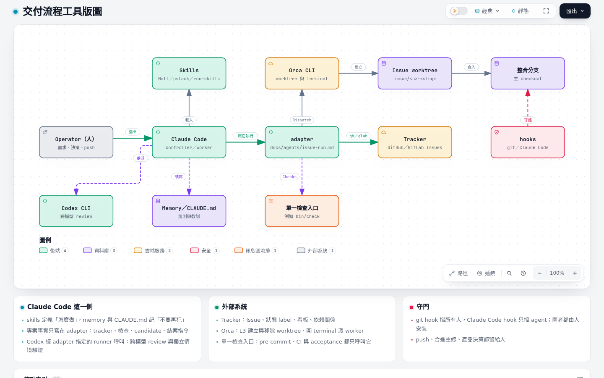

# 01 工具與角色

流程裡有五種角色，靠五類工具串起來。先記住一條邊界：**agent 做到本機 candidate commit 為止；push、合進共用分支、產品決策，以及對共用環境（資料庫、正式站）的操作，都留給人。** 到 L3 這條邊界也只放寬到「adapter 明文允許的 push、開 PR／MR 與合進主線」。

互動版：[diagrams/01-tooling.html](diagrams/01-tooling.html)（來源 [`diagrams/src/01-tooling.architecture.json`](diagrams/src/01-tooling.architecture.json)）

## 角色

| 角色 | 在哪裡跑 | 負責 | 不做 | 從哪一級出現 |
| --- | --- | --- | --- | --- |
| **Operator**（人） | 自己的終端與對話 | 提需求、回答釐清問題、產品決策、對共用環境執行 artifact 並讀回、push、合併 PR／MR（L3 的 adapter 交給 coordinator 時除外） | 不手動把分支合進整合分支（L2 起一律經入口腳本） | L1 |
| **controller** | 輸入 `/issue-run <n>` 或 `/issue-run --pool` 的那個 session | 單張或一組 Issue 的 Gate → Graph → Claim → Build → Candidate → Report；做到 candidate 停下來報告（adapter 允許時自己 push、開 PR／MR、合進主線並結案） | adapter 沒有允許時不 push、不合進共用分支、不結案 | L1 |
| **subagent**（Claude） | controller 以 Agent 工具派出 | 多張 ticket 時的 implementer（`implement-spec`）、`code-review` 的 Standards／Spec 兩軸審查 | 不跨出指派的 worktree；結論交回 controller 判讀 | L1 |
| **coordinator** | 主 checkout 的 `/loop /issue-pilot` | 對帳、挑單、組批次、派 worker、整批回歸、合入整合分支、交出 push 指令（adapter 允許時自己 push、開 PR／MR、合進主線）、結案；決定記在 `.scratch/pilot/decisions.md` | 不寫產品程式碼；同一個 repo 同時只有一個 coordinator | L3 |
| **worker** | 每張 Issue 自己的 worktree，跑 `/issue-run <n> --worker <checkpoint>` | 單張 Issue 的實作、本單檢查、review，做到 candidate，最後一行印 `DONE <n> <SHA>` 或 `STOP <n> <原因>`；候選落地後要立刻跑一次的指令在 `DONE` 前印成 `POSTLAND <n> <指令>` | 不問人（產品問題留言到 Issue 後 `STOP`）；不合入、不 push、不結案 | L3 |
| **Codex** | 經 adapter 指定的 runner 腳本呼叫 | 只做 code review：跨模型 review、兩輪 review 後仍有爭議的 finding 的第二意見 | 不 commit；結果由 controller 判讀 | L3（L1／L2 可選） |

controller 與 worker 是同一個 `/issue-run` skill 的兩種模式：沒有 coordinator 時你自己打 `/issue-run <n>`，它就是 controller；在 L3 由 coordinator 派出時加 `--worker`，它就只做到 candidate、用最後一行回報。`--pool` 也是 controller：它在同一個 session 從池子依序認領、一次跑一張，不開分頁、不並行，不需要 Pilot 段，只要 repo 有 `scripts/issue-pool.mjs`。

## 工具

| 工具 | 角色 | 邊界 |
| --- | --- | --- |
| **Claude Code** | 跑 skills、呼叫 scripts、讀寫 memory | 權限由 repo 的 `.claude/settings.json` 決定，只有人能改（見 [04 權限規則](04-level2.md#權限規則)） |
| **skills**（`~/.claude/skills/`） | 定義「怎麼做」 | 使用者層由 ron-skills 的 `bin/sync-skills` 連結 Matt、pstack 與 ron-skills 三層；專案層放在 repo 的 `.claude/skills/`。上游原始檔不改，個人調整用 `overlays/*.patch` |
| **adapter**（`docs/agents/issue-run.md`） | 定義「在這個 repo 用哪些指令」 | 專案事實只寫在這裡；skill 本身不含任何專案路徑。範本是 [`ADAPTER.md`](../../skills/engineering/issue-run/ADAPTER.md) |
| **hooks** | git hooks（pre-commit、pre-push）與 Claude Code hooks（`PreToolUse` 等）把規則變成擋得住的檢查 | git hook 擋所有人，Claude Code hook 只擋 agent；兩者都要由人安裝 |
| **tracker** | Issue、狀態 label、看板、依賴關係 | GitHub 用 `gh`，GitLab 用 `glab`；讀寫指令寫在 `docs/agents/issue-tracker.md` |
| **Orca** | 建立與移除 worktree、開 terminal 派 worker、交棒 | 可用性看環境變數 `ORCA_CLI_COMMAND`，不要用 `which orca`（那是 GNOME 螢幕閱讀器）。L1／L2 可不用；L3 的派工與監看靠它 |

## 支援平台

正本、測試與 `bin/` 在下面支援的三種平台都要能通過檢查入口。`/setup-workflow` 的環境站會偵測這台機器的平台，並問團隊還有誰用哪些平台，記進 adapter 的 `## Platforms`。

| 平台 | 支援 | 說明 |
| --- | --- | --- |
| WSL2 | 支援 | Windows 上的使用方式。Orca 從 WSL 呼叫時有幾個專屬的坑與 workaround，見 [08 常見坑](08-pitfalls.md#wsl) |
| macOS | 支援 | Orca 指令是 Orca.app 內 `orca` 的絕對路徑，設在 `ORCA_CLI_COMMAND` |
| Linux | 支援 | 一般發行版；`orca` 這個名稱可能是 GNOME 螢幕閱讀器，Orca 可用與否只看 `ORCA_CLI_COMMAND` |
| 原生 Windows | 不支援 | 環境站在這裡停下、不寫檔，提示改用 WSL2 |

## 參考來源：三層 skill 從哪來

本流程不是從零寫的。skills 分三層疊起來，下層是兩個公開的上游，上層是 ron-skills 的個人層，再往上是各專案自己的 adapter：

| 層 | 來源 | 放什麼 | 誰改 |
| --- | --- | --- | --- |
| **Matt Pocock skills** | 上游 [mattpocock/skills](https://github.com/mattpocock/skills)；本機 clone 的是 fork [ron03wlb/skills](https://github.com/ron03wlb/skills)，只追上游 | 工程方法：`tdd`、`code-review`、`implement`、`implement-spec`、`triage`、`retro`、`grilling`、`to-spec`… | 不改；只同步上游 |
| **pstack** | 上游 [backnotprop/pstack](https://github.com/backnotprop/pstack) | 編排原則：`poteto-mode` 的 Autopilot playbook、`principle-*`、`arena` | 不改；只同步上游 |
| **ron-skills（個人層）** | [ron03wlb/ron-skills](https://github.com/ron03wlb/ron-skills)，本 repo | 交付編排：`issue-run`、`issue-pilot`、`issue-queue`、`retro-collect`、`setup-workflow`、`session-handoff`；對上兩層的 overlay；`setup-workflow` 複製給各專案的 script 正本 | 自己 |
| **專案 adapter** | 各 repo 的 `docs/agents/issue-run.md` | 這個 repo 的 tracker、檢查、candidate、交付指令 | 各專案 |

**為什麼這樣分。** 判斷標準只有一條：上游更新之後，個人層要仍然相容，原有工作流不變。所以：

- **採用 Matt 的方法**當工程程序：測試先行、兩軸 review、spec 拆單這些已經寫得夠好，不重寫，`/issue-run` 直接照它們做。
- **採用 pstack 的原則**當無人值守時的判斷依據：coordinator 怎麼派工、何時停、怎麼選做法，引用 `poteto-mode` 與 `principle-*`，不自己另訂一套。
- **不採用的上游 skill 寫明理由**：Matt 要連哪些、刻意不連哪些記在 `matt-skills.txt`；pstack 的白名單記在 `pstack-skills.txt`。pstack 不連結的理由只有三種：與 Matt 或個人層的流程重疊（例如它的 `tdd` 與 Matt 的重複）、與 repo 規範衝突（例如刪註解策略、英文句式規則），或只給 Cursor 用。
- **個人層只放上游沒有的東西**：Issue 進池子、認領、worktree、整合分支、常駐 coordinator、retro 收集這一整條交付線，以及對上游的最小補丁。「把 skill 都搬進同一個 repo」本身不是目標。
- **專案事實只放 adapter**：skill 本身不含任何專案路徑或指令，換一個 repo 只要換 adapter。Matt 的方法和 adapter 說法不同時，以 adapter 為準；`/issue-run` 會在報告裡列出這次用到的每一條覆寫。

**overlay 機制。** 個人層要改上游 skill 時，不改上游的 checkout，也不 fork 一份自己維護：

1. 改動寫成 `overlays/<name>.patch`，一個 skill 一個補丁，只放最小差異（例如給 `code-review` 的子代理指定模型、讓 `retro` 在有收集條目時改開 Issue）。
2. `bin/sync-skills` 把上游的 skill 複製到 `~/.local/share/ron-skills/overlay/<name>`，在副本上套補丁，再把 `~/.claude/skills/<name>` 連到副本。上游 checkout（`~/code/skills`、`~/code/pstack`）本身一個字都不動，`git pull` 永遠是快轉。
3. `bin/sync-skills --check` 只檢查不寫：每個補丁能不能套在目前的上游版本、上游有沒有新增 skill 要決定連不連。上游改到補丁的位置時印 `OVERLAY_FAILED`，連結保持舊版，重做那個補丁再同步。
4. 升級上游時，先 `--check` 通過、試跑過，再更新 `matt-skills.txt`／`pstack-skills.txt` 的 `# pin:`（驗證過的上游 SHA）。ron-skills 的 CI 每週對上游最新 main 跑一次 `bin/check --upstream`，上游一改到補丁位置就先在 CI 變紅。

每個補丁改了什麼，列在 ron-skills 根目錄 [`README.md`](../../README.md) 的「overlays 清單」。

## 常見的線

| 線 | 實際動作 |
| --- | --- |
| Operator → Claude Code | `/triage <n>`、`/issue-run <n>`、`/loop /issue-pilot`、回答 gate |
| Claude Code → tracker | adapter 的 Tracker 段指令（`gh issue …`／`glab issue …`） |
| Claude Code → 檢查 | adapter 的 Checks 段：一條單一檢查入口（例如 `bin/check`） |
| Claude Code → Codex | adapter 指定的 runner；沒有 runner 時改用 `code-review` skill |
| coordinator → Orca | adapter Pilot 段的 Dispatch、Watch 指令 |
| Operator → remote | `git push`、開 PR／MR、合併 |
