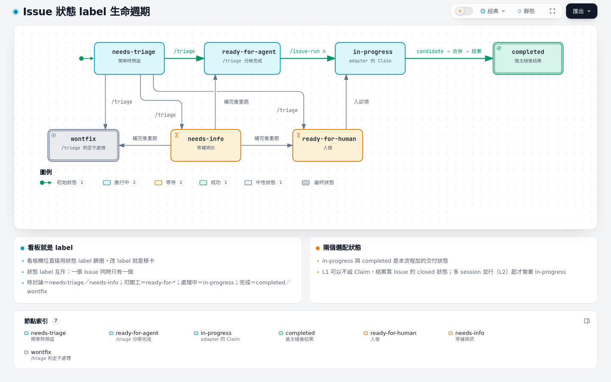
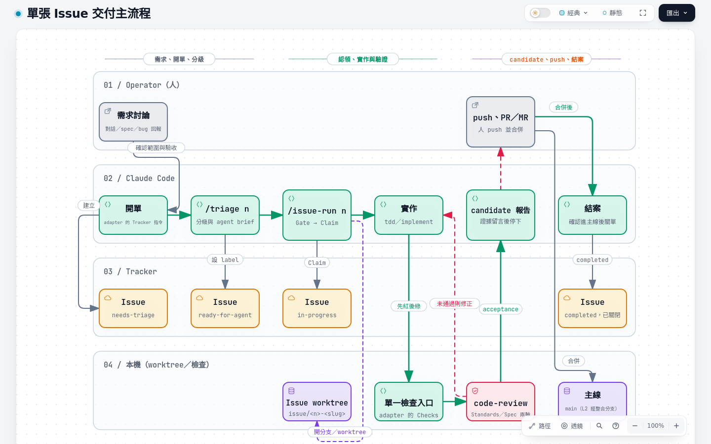

# 02 Issue 生命週期

## 狀態 label

Matt 的 `triage` skill 定義五個分級角色；本流程再加兩個交付狀態。每個角色對應到 tracker 上的哪個 label 字串，寫在 repo 的 `docs/agents/triage-labels.md`（`/setup-matt-pocock-skills` 產生），換字串只改那張表。

| label | 意思 | 誰設 | 下一步 |
| --- | --- | --- | --- |
| `needs-triage` | 剛開、還沒人評估 | 開單時預設 | `/triage <n>` |
| `needs-info` | 等開單的人補資訊 | `/triage` | 補完後再 `/triage <n>` |
| `ready-for-agent` | 規格完整，agent 可以無人值守做完 | `/triage` | `/issue-run <n>`；L3 由 coordinator 從池中挑 |
| `ready-for-human` | 需要人做（產品判斷、無法自動驗證、共用環境操作） | `/triage` | 人做完後結案 |
| `wontfix` | 不處理 | `/triage` | 結案 |
| `in-progress` | 已被認領，有人或 agent 正在做 | adapter 的 Claim 指令 | 等 candidate 或 STOP |
| `completed` | 已合進主線並結案 | 結案時 | 無 |

狀態 label 互斥：一張 Issue 同時只有一個。`in-progress` 與 `completed` 是選配：L1 可以不設 Claim（adapter 的 Claim 段預設 none），結案靠 Issue 的 closed 狀態；開始多 session 並行（L2）之後，`in-progress` 才是防止兩個人搶同一張的訊號。

互動版：[diagrams/02-issue-labels.html](diagrams/02-issue-labels.html)（來源 [`diagrams/src/02-issue-labels.lifecycle.json`](diagrams/src/02-issue-labels.lifecycle.json)）

`in-progress` 的單 `STOP` 時狀態不變：原因留言在 Issue 上，等人決定。

## 看板就是 label

看板的欄位直接用狀態 label 篩選，改 label 就是移卡，不另外維護一份狀態。

| 看板欄位 | label |
| --- | --- |
| 待討論 | `needs-triage`、`needs-info`，或沒有狀態 label |
| 可開工 | `ready-for-agent`、`ready-for-human` |
| 處理中 | `in-progress` |
| 完成／不處理 | `completed`、`wontfix`、已關閉 |

- GitHub：Projects 的 board view，以 label 欄位分組；或直接用 `gh issue list --label <label>` 當看板。
- GitLab：Issue board 的每個 list 設成一個 label。

## 從開單到結案

互動版：[diagrams/02-main-flow.html](diagrams/02-main-flow.html)（來源 [`diagrams/src/02-main-flow.workflow.json`](diagrams/src/02-main-flow.workflow.json)）

| 階段 | 入口 | 結果 |
| --- | --- | --- |
| 需求 | 對話、spec、bug 回報；要釐清時先 `/grilling` 或 `/to-spec`，要拆票時 `/to-tickets` | 範圍與驗收條件 |
| 開單 | 下方的開單指令 | `needs-triage` |
| 分級 | `/triage <n>` | `ready-for-agent`／`ready-for-human`／`needs-info`／`wontfix`；ready 的單附上 agent brief |
| 認領 | adapter 的 Claim 指令（`/issue-run` 自己跑） | `in-progress`；L2 起此時才開 worktree |
| 實作 | `/issue-run <n>`：單張照 `implement`，多張照 `implement-spec`；先寫會紅的測試（`tdd`） | 本機 commit |
| 驗證 | adapter 的 Checks 指令，再跑 `code-review`（Standards／Spec 兩軸，最多兩輪修正） | candidate commit，證據貼成 Issue 留言 |
| 交付 | 人 push、開 PR／MR、合併 | candidate 進到主線 |
| 結案 | 確認 candidate 已在遠端主線後關單 | `completed`；刪掉工作分支與 worktree |

`/issue-run` 在 Gate 一步就會擋下不合格的單：狀態不是 adapter 的 ready 狀態、preflight 不是 exit 0、或有還沒合入的 blocker。它不會自己跑 `/triage` 補規格，只告訴你缺什麼、該跑哪個入口。

## tracker 指令對照

| 動作 | GitHub（`gh`） | GitLab（`glab`） |
| --- | --- | --- |
| 開單 | `gh issue create --title "…" --body-file body.md` | `glab issue create --title "…" --description "$(cat body.md)"` |
| 讀單（含留言） | `gh issue view <n> --json number,title,body,labels,comments` | `glab issue view <n> --comments` |
| 列出可開工 | `gh issue list --state open --label ready-for-agent` | `glab issue list --label ready-for-agent` |
| 改狀態 | `gh issue edit <n> --add-label in-progress --remove-label ready-for-agent` | `glab issue update <n> --label in-progress --unlabel ready-for-agent` |
| 留言 | `gh issue comment <n> --body-file note.md` | `glab issue note <n> --message "$(cat note.md)"` |
| 結案 | `gh issue close <n> --comment "…"` | `glab issue close <n>` |
| 建 label | `gh label create ready-for-agent` | `glab label create --name ready-for-agent` |
| 開 PR／MR | `gh pr create --base main --head <branch>` | `glab mr create --target-branch main --source-branch <branch>` |

依賴關係（A 被 B 擋住）：GitHub 用原生的 issue dependencies（`gh api repos/<owner>/<repo>/issues/<n>/dependencies/blocked_by`）；GitLab 用 issue links 的 `blocks`／`is_blocked_by`，沒有這個功能的方案就在本文寫一行 `Blocked by: #<n>`。不論哪種，blocker 關閉才算解除。

> `gh issue view <n> --comments` 在非 tty 環境（agent 的 Bash 工具）不會輸出任何東西；agent 讀單一律用 `--json`。

## 批次

幾張相關的 Issue 一起交付時：

- **手動（L1／L2）**：`/issue-run <n> <m> …`。controller 依 tracker 的依賴建 task graph，照 `implement-spec` 每張一個 worktree、各自做到綠燈後合進本次的整合分支，最後在整合分支 tip 跑一次 acceptance。
- **池子（L1／L2）**：`/loop /issue-run --pool [<N>]`。同一個 session 照 `scripts/issue-pool.mjs` 的 `ready` 順序先認領再開工，一次一張，每張照 `/issue-run <n>` 跑完；最多跑 `<N>` 張，預設跑到池子空。每次醒來先接續自己認領、還沒做完的單，再撿新單；一張停下時在那張單留言寫明停在哪一步，依賴它的單跳過，其他照跑，醒來的最後一次回報。池子空了就拉長間隔，不結束 loop。repo 沒有 `scripts/issue-pool.mjs` 時停下，提示跑 `/setup-workflow`。
- **常駐（L3）**：coordinator 每批挑幾張，每張派一個 worker；全部 `DONE` 或 `STOP` 之後，在批次分支依號碼合入、在 staged SHA 跑一次回歸、過了才合進整合分支（見 [05 L3 導入](05-level3.md)）。

一張 Issue 被另一張 STOP 的單擋住時，只有它停；其他獨立的單照常前進。
