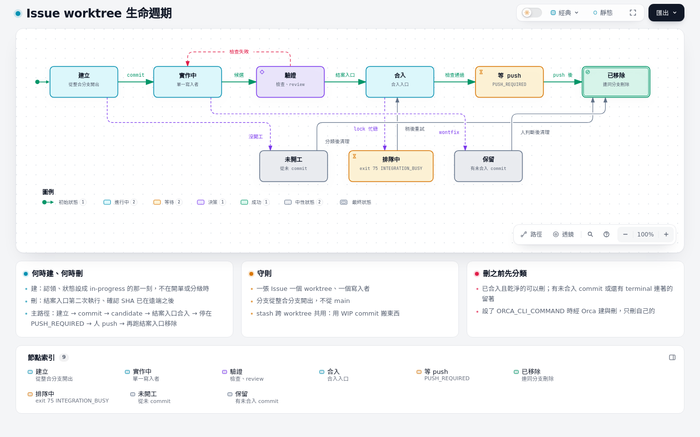

# 04 L2 導入

L1 靠「agent 照 skill 做」維持秩序；只要同時有兩個以上的 session、或有人另開終端手動 commit，這份秩序就擋不住。L2 把幾個容易出事的動作收成**入口**：每個動作只有一條路，路上有檢查，失敗時印出修正指示。

本章只寫每個入口的**契約**（必須做什麼、exit code、拒絕什麼），不提供腳本：入口用什麼語言、怎麼實作由各 repo 自己決定。唯二的範本是 pre-push hook 與 `pilot_git.py`。

## 什麼時候進 L2

- 同時開兩個以上的 session 交付不同 Issue，開始互相踩檔案或分支。
- 發生過有人繞過檢查合入、合錯分支、或關了還沒進主線的 Issue。
- L1 的 `/issue-run` 已經穩定，Issue 本文和 adapter 不再頻繁改。

## worktree 規則

- **一張 Issue 一個 worktree、一個寫入者。** 改某張 Issue 的程式只在它的 worktree 裡做；臨時發現的 bug 先開 Issue，不順手改。
- **認領時才建。** 狀態設成 `in-progress` 的那一刻建 worktree，不要開單就建，否則會留下一堆空 worktree。
- **從整合分支開出。** 分支 `issue/<n>-<slug>`，base 是整合分支目前的 tip，不是 `main`。
- **有 Orca 就經 Orca。** 設了 `ORCA_CLI_COMMAND` 時用 `orca worktree create`／`worktree rm`，Orca 才追蹤得到；沒有 Orca 用 `git worktree add`。
- **stash 是共用的。** `git stash` 清單跨所有 worktree 共用，不要用它在 worktree 之間搬東西；用暫時的 WIP commit，或 `git show <sha>:<path>`。
- **刪之前先分類。** 已合入且乾淨的可以刪；有未合入 commit、或還有 terminal 連著的留著。只刪自己的。



互動版：[diagrams/04-worktree.html](diagrams/04-worktree.html)（來源 [`diagrams/src/04-worktree.lifecycle.json`](diagrams/src/04-worktree.lifecycle.json)）

## 整合分支與 lock

整合分支是本機與遠端共用的累積點（例如 `integration`，最後開 PR／MR 合進 `main`）。所有 Issue 分支都先合進它，push 也是 push 它。

**合入入口契約**

| 項目 | 契約 |
| --- | --- |
| 必須做 | 取得整合分支的 lock；確認要合入的 SHA 已在**自己的 SHA 上**通過單一檢查入口；`git merge --no-ff` 合入；合入後在新 tip 再跑一次單一檢查入口；釋放 lock；印出合入後的 SHA |
| exit code | `0` 合入且檢查通過；`1` 檢查失敗（已還原到合入前）；`2` 參數或前置條件不符；`75` lock 被別人持有（`INTEGRATION_BUSY`，稍後重試，不要自己寫等待迴圈） |
| 拒絕 | 沒有 lock 的合入；整合分支有未 commit 的改動；要合入的 SHA 沒有通過紀錄；hold 旗標存在時 |

配套的 git `reference-transaction` hook 可以擋掉不經這個入口的合入與改寫整合分支歷史（`reset`、`rebase`、多 commit 的 fast-forward）；做不到就至少在 pre-push 檢查整合分支只往前走。

## pre-push

push 是最後一道本地關卡：hook 在**要 push 的那個 SHA** 上重跑單一檢查入口，而不是在你目前的工作樹上跑，所以別的 session 同時改了工作樹也不影響結果。

**pre-push hook 契約**

| 項目 | 契約 |
| --- | --- |
| 必須做 | 對每個要 push 的 ref，在暫時的 detached worktree 檢出該 SHA，跑單一檢查入口 |
| exit code | `0` 全部通過才放行；非 0 擋下整次 push |
| 拒絕 | 任何檢查失敗的 SHA；刪除 ref 不檢查 |

範本（存成 `.githooks/pre-push`，`chmod +x`，再 `git config core.hooksPath .githooks` 啟用；hook 印給 agent 看的訊息用英文）：

```bash
#!/usr/bin/env bash
# pre-push: run the single check entry on the exact commit being pushed, not on the working tree.
set -euo pipefail
CHECK=${CHECK:-bin/check}   # the repo's single check entry
while read -r local_ref local_sha remote_ref remote_sha; do
  [[ $local_sha =~ ^0+$ ]] && continue   # deleting a ref: nothing to check
  tmp=$(mktemp -d)
  git worktree add --quiet --detach "$tmp" "$local_sha"
  if ! (cd "$tmp" && $CHECK); then
    git worktree remove --force "$tmp"
    echo "pre-push: $CHECK failed at $local_sha ($local_ref). Fix the failure and push again; do not bypass with --no-verify." >&2
    exit 1
  fi
  git worktree remove --force "$tmp"
done
```

git hook 擋得住人，但 agent 可以加 `--no-verify` 跳過它；要連這個也擋，再加一個 Claude Code `PreToolUse` hook，拒絕含 `--no-verify`、`git commit -n`、`-c core.hooksPath=` 的 Bash 指令（見 [06 品質校驗時間軸](06-quality-gates.md#1-編輯時)）。

## 兩段式結案

L1 的結案是人看到 PR 合併後手動關單。L2 把它收成一個入口，分兩次執行，中間隔著 push：

**結案入口契約**

| 項目 | 第一次 | 第二次 |
| --- | --- | --- |
| 必須做 | 經合入入口把 candidate 合進整合分支；印出要 push 的 SHA 與 push 指令 | `git fetch` 後確認該 SHA 已在遠端整合分支（`git merge-base --is-ancestor <sha> origin/<integration>`）；貼證據留言；關單並設 `completed`；刪 worktree 與本機、遠端的工作分支 |
| exit code | `3` 停在 `PUSH_REQUIRED`（不是錯誤，是等人 push 的停點）；其他非 0 照合入入口 | `0` 已結案；`3` SHA 還不在遠端，仍是 `PUSH_REQUIRED` |
| 拒絕 | Issue 不是 `in-progress`；還有開著的子單 | SHA 不在遠端時關單 |

這樣「關了但還沒進主線」的 Issue 就不會出現：關單的前提由入口查，不靠人記得。

## `/retro`

每次 session 結束、或同一種失誤出現第二次時，輸入 `/retro`。它讀這次 session 的紀錄，提出環境改善：缺的導覽指標、該加的自動檢查、該刪的無效規則。採用的改善放在 retro 分支，不開 Issue；只改工具與文件。有 Orca 時，`/retro` 結束前最後一步把分頁標題換成 `待關閉｜`（`node scripts/tab-state.mjs 待關閉`），之後分頁可以關。

新增的檢查要先證明自己：把真實發生過的那次錯誤做成 fixture，附指令與 exit code 證明檢查在它上面會失敗（見 [07 規則沉澱](07-rules.md)）。

## 權限規則

無人值守的 agent 需要 `.claude/settings.json` 的 allow 規則才不會每一步都停下來問。規則只由人改，只有一條原則：**`*` 只放在規則最後，放在 git 會當成選項解析的參數之後。**

- 不要寫 `Bash(git -C * fetch origin)`：`-C` 後面的 `*` 也吞得下 `-c core.sshCommand=<指令>` 這類 git 全域選項，等於放行任意指令。Claude Code 每次啟動都會警告 `allows any option at its *`；把路徑寫死成前綴一樣會警告。
- 已經把 git 寫入包進交付腳本的 repo（合入入口、結案入口），allow 只放行那幾支腳本，腳本裡面才跑 `git -C`。
- 還沒有交付腳本的 repo，用範本 [`pilot_git.py`](../../skills/engineering/issue-run/templates/pilot_git.py)：
  1. 複製成 repo 的 `scripts/pilot_git.py`，改兩個常數（分支前綴、base 分支）。主 checkout 與 worktree 根目錄依機器偵測，不是常數：主 checkout 是環境變數 `PILOT_GIT_MAIN_CHECKOUT`，沒有時取 script 所在 repo 的 `git rev-parse --path-format=absolute --git-common-dir` 的上一層；worktree 根目錄是 `PILOT_GIT_WORKTREE_ROOT`，沒有時是 `~/orca/workspaces/<主 checkout 目錄名>`；偵測結果在某台機器上不對時才設。它先驗證目標與參數再執行 `git -C`：主 checkout 只能 `fetch`、`rev`、`log`；寫入（`sync`、`stage`、`push`）只能到 `<worktree 根目錄>/<前綴>*`；參數不得以 `-` 開頭；`push` 只推 `<前綴>*` 分支。驗證失敗 exit 2。
  2. allow 換成一條 `Bash(python3 scripts/pilot_git.py:*)`，刪掉所有 `Bash(git -C …)`。
  3. adapter 裡的 git 步驟一律寫成 `python3 scripts/pilot_git.py <子命令> <checkout> …`，並加一個測試：adapter 每條指令都有對應的 allow 規則、沒有直接呼叫 `git -C` 的步驟。
  4. 開一個新 session，確認啟動時沒有權限警告。

## exit code 慣例

所有入口用同一組 exit code，agent 與 hook 才能不讀說明就判斷下一步：

| exit | 意思 | 呼叫者該做什麼 |
| --- | --- | --- |
| `0` | 完成 | 往下一步 |
| `1` | 檢查失敗 | 讀輸出修正，再跑一次 |
| `2` | 拒絕：參數、目標或前置條件不符 | 改呼叫方式；不要重試同一條指令 |
| `3` | 停點：需要人做一件事（例如 `PUSH_REQUIRED`） | 把印出的指令交給人，做完再跑一次 |
| `75` | 共用資源忙碌（`INTEGRATION_BUSY`） | 稍後重試 |

每個入口失敗時的最後一行，都要是一條能照抄執行的修正指示。
