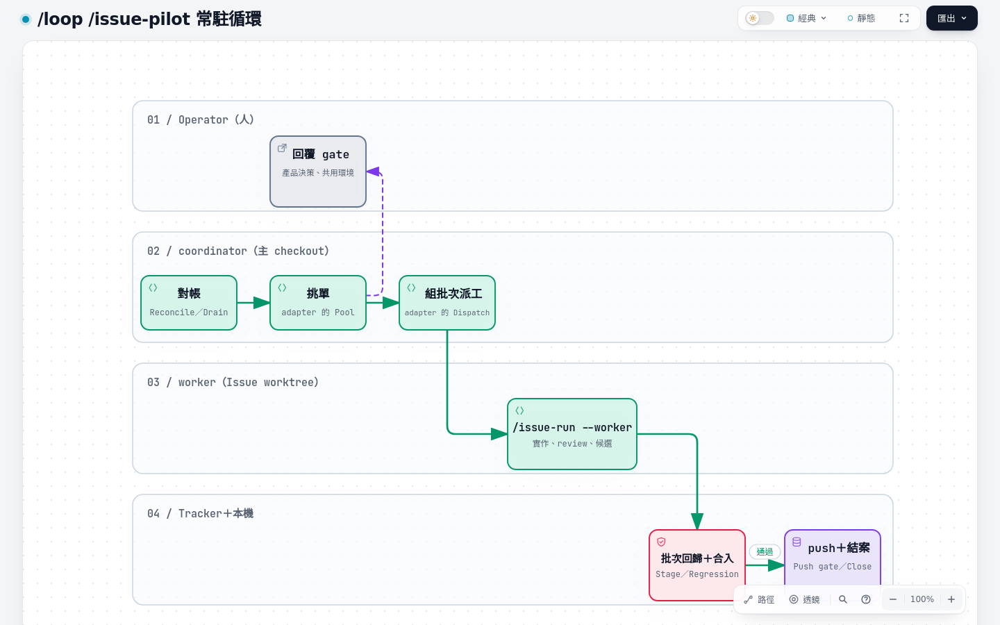

# 05 L3 導入

L3 讓一個常駐的 **coordinator** 接手 L2 裡由你下指令的部分：它自己從 tracker 挑 `ready-for-agent` 的單、每張派一個 worker、整批回歸後合進本機整合分支，再把 push 指令交給你；adapter 允許時則自己 push、開 PR／MR、合進主線並結案。你只剩三件事：產品決策、對共用環境執行 artifact 並讀回、`git push` 與合併（除非 adapter 交給 coordinator，ron-skills 就是這樣設定）。

## 進入條件

- L2 的入口都已存在，而且每個都有固定的 exit code 與一行修正指示：coordinator 靠 exit code 判斷下一步，不讀散文。
- 裝了 Orca，且在 Orca 的 terminal 裡 `ORCA_CLI_COMMAND` 有設定：派 worker、監看、交棒都經 Orca。
- 權限規則照 [04 權限規則](04-level2.md#權限規則) 設好，新 session 啟動沒有警告。
- adapter 有 **Pilot** 段（見下方）。沒有這段時 `/issue-pilot` 直接停下並說明。

## `/loop /issue-pilot`

在主 checkout（或 adapter Pilot 段 **Coordinator checkout** 指定的 checkout）執行：

```text
/loop /issue-pilot
```



互動版：[diagrams/05-pilot-loop.html](diagrams/05-pilot-loop.html)（來源 [`diagrams/src/05-pilot-loop.workflow.json`](diagrams/src/05-pilot-loop.workflow.json)）

`/loop` 讓它自己排下一次喚醒；每次醒來跑一輪（tick）：

1. **Reconcile 對帳**：讀 `.scratch/pilot/` 的狀態檔、其他 session 轉來的請求、還開著的 gate，用 Watch 指令唯讀查看每個 worker。
2. **Drain 收件**：每個做完的 worker 分成 `DONE`（記下 candidate SHA）、`STOP`（照停因處理）或問題（只依 adapter 或 skill 的規則回答，產品問題變成 gate）。
3. **Project hooks**：跑 adapter 列的專案檢查（見下方 tick hooks）。
4. **Pick 挑單**：worker 數低於上限時，依 adapter 的 Pool 規則挑下一批；`needs-triage` 的單先照 Readiness 補齊。
5. **Dispatch 派工**：每張開一個 worktree 與 terminal，執行 `/issue-run <n> --worker <batch checkpoint>`。
6. **Land 落地**：整批成員都 `DONE` 或 `STOP` 後，在批次分支依號碼合入、在 staged SHA 跑回歸、通過才合進整合分支，然後照 Push gate 交出 push 指令；adapter 允許時自己 push、開 PR／MR、合併，接著結案。
7. **Report and sleep**：重產 `status.md`，有需要人做的事才通知；排下一次喚醒（有 worker 在跑時 1200 秒，閒置時 1800 到 3600 秒）。

它的狀態全在磁碟上（`.scratch/pilot/` 與各批次 checkpoint），不靠對話記憶：

| 檔案 | 內容 |
| --- | --- |
| `preferences.md` | standing orders：worker 上限、批次大小、誰合入、誰 push |
| `gates.md` | 等人回覆的問題、選項、已套用的預設 |
| `decisions.md` | 每個決定的理由、證據、結果 |
| `status.md` | 從 checkpoint 重產的現況，不手寫 |
| `requests.md` | 其他 session 轉來的請求（插單、hold、stop） |
| `sessions.md` | 每個 coordinator session 一行，給 `/retro` 找紀錄 |

這張表只說各檔案的用途。每個檔案的路徑、逐行格式與合法值（包括 `coordinator`、`hold` 與批次 checkpoint）只寫在 [`PILOT-STORE.md`](../../skills/engineering/issue-pilot/PILOT-STORE.md)，各專案的 adapter 不再另寫一份。

在其他 session 輸入 `/issue-pilot <n>`、`/issue-pilot hold`、`/issue-pilot stop`，請求會轉給正在跑的 coordinator，不會多開一個。

**交棒**：coordinator 刻意短命。合入幾批（ron-skills 是 2 批）或遇到 compaction 後，它在安全點停掉自己的背景工作、在新的 session 接手 `/loop /issue-pilot`，舊 session 退役。

## adapter 的 Pilot 段

L3 的專案事實全寫在 adapter 的 `## Pilot` 段，每一條一個項目。範本與每條的 Default 見 [`ADAPTER.md`](../../skills/engineering/issue-run/ADAPTER.md) 的 Pilot 段；實例見 ron-skills 的 [`docs/agents/pilot.md`](../agents/pilot.md)：Pilot 段只留一行指向它，條目之間空一行，讓改不同條目的修改落在不同的 hunk。整合分支上的 adapter 與 coordinator checkout 的不同時（例如主線好幾個小時沒 push），coordinator 改讀整合分支上的 Pilot 段（以及它指向的檔案），因為下一批就在那個分支上 stage。

| 條目 | 寫什麼 |
| --- | --- |
| Coordinator checkout | coordinator 在哪個 checkout 跑、`.scratch/pilot/` 放哪 |
| Sessions | 怎麼登記 coordinator session |
| Defaults | worker 上限、每批張數、誰合入、誰 push 與合併 PR／MR、何時交棒 |
| Integration branch | 本機整合分支的名稱、怎麼開、合進主線後怎麼跟上 |
| Pool | 挑單的查詢與排序；被擋住或已在其他批次的單怎麼濾掉 |
| Batch | 批次 checkpoint 由哪個步驟建立；檔名、欄位與狀態值照 [`PILOT-STORE.md`](../../skills/engineering/issue-pilot/PILOT-STORE.md) |
| Brief check | 拒絕缺欄位 brief 的指令（goal、scope、acceptance、verify、timebox、forbidden、report、standing orders 路徑） |
| Dispatch | 開 worktree 與 terminal 並送出 `/issue-run <n> --worker …` 的指令 |
| Watch | 唯讀讀取 worker 畫面的指令；最後一行 `DONE`／`STOP` 就是做完 |
| Agent rows | 每個派出的 agent 記在哪 |
| Probe | 每輪對帳的指令或步驟 |
| Hold flag | 哪個合入步驟在合入前檢查 `hold` |
| Stage | 開批次分支、依序合入 `DONE` 的成員；哪些衝突 coordinator 可以自己解 |
| Regression | 在 staged SHA 跑什麼、怎樣算過 |
| Integrate | 合進整合分支的條件與指令 |
| Push gate | 整合分支 tip 等於最後通過回歸的 SHA 時要跑的 push 指令：交給人，或 adapter 允許時由 coordinator 依序 push、開 PR／MR、合併，再讓整合分支跟上主線 |
| Close | 進到主線之後的證據留言、關單、關掉成員 terminal、移除 worktree 與分支（遠端沒有該分支時略過） |
| Handoff | 交棒的指令 |
| Project tick hooks | 每輪要跑的專案檢查 |
| Retro collect | `/retro-collect` 需要的事實 |

沒有專用腳本也能起步：Probe、Watch 可以先寫成手動指令序列，等真的跑出摩擦再做成腳本。ron-skills 就是這樣：手拼 probe 漏過 terminal 已結束卻沒有結果行的 worker，之後才把 Probe 做成 `scripts/pilot-probe.mjs`，一次印出主 checkout、開著的請求與 gate、各 worker 與 batch 的狀態。Push gate 也一樣：先在 adapter 寫成 push、開 PR、等 CI、合併、跟上主線的指令序列，實際跑過之後才收斂成 `scripts/land.mjs`。pilot 帶 `--keep-branch`，保留整合分支並讓它以 `--ff-only` 跟上主線；手動分支（retro、單獨跑的 `/issue-run`）不帶，合入後一併移除 worktree 與分支。兩者共用同一個結果行：`LANDED <pr> <merge sha>` 或 `STOP <原因>`，每一步都能從中斷處重跑。

## tick hooks

專案自己每輪要做、ron-skills 不認識的檢查（例如每日資料採集的派發、API 額度檢查），寫在 Pilot 段的 **Project tick hooks**：每輪在 Drain 之後、Pick 之前，從 coordinator checkout 依序執行。exit 0 繼續；非 0 開一個 gate（附 exit code 與輸出尾段），這一輪跳過 Pick 與 Dispatch，已在跑的 worker 與 Land 照常；下一輪再跑一次，exit 0 就自動解除 gate。沒寫這一行就整步略過。

## Orca

| 用途 | 做法 |
| --- | --- |
| 派工 | 三步：`orca worktree create`（不帶 `--repo`、不帶 `--agent`）→ `orca terminal create --command claude` → 用會確認送達的送出腳本送 `/issue-run <n> --worker <checkpoint>`；worktree 路徑與 terminal handle 記進批次 checkpoint；`worktree create` 之後確認主 checkout 沒有被設成 bare（見 [08 常見坑](08-pitfalls.md)） |
| 監看 | `orca terminal read --terminal <handle>`：畫面最後一行是 `DONE <n> <sha>` 或 `STOP <n> <原因>` 就是做完；terminal 已結束但沒有這行就是卡住 |
| 結案 | `orca worktree rm` 移除 worktree，Orca 不會留下孤兒紀錄；rm 之後確認主 checkout 沒有被設成 bare（見 [08 常見坑](08-pitfalls.md)） |
| 每個 tick | coordinator 每次被叫醒先確認主 checkout 沒有被設成 bare：Orca 的 worktree 操作可能稍後才改動 `core.bare`（見 [08 常見坑](08-pitfalls.md)） |

確切的子命令與旗標以專案 adapter 的 Dispatch、Watch、Close 行為準（ron-skills 用 `orca-ide`）。從 WSL 呼叫 Orca 時，`worktree create` 常先回 `runtime_unavailable` 或 `runtime_timeout` 但其實已經建好：只呼叫一次，用 `git worktree list` 確認，不要重試（見 [08 常見坑](08-pitfalls.md)）。

## Codex 跨模型 review

L1／L2 的 review 是 Claude 的 `code-review` skill。L3 在 adapter 的 Review 段加上 Codex 的 runner，用在三個地方：

- **高風險 Issue 的獨立情境驗證**：adapter 列的高風險類別（權限、金流寫入、跨模組路徑之類）在 candidate 產生後，由沒寫程式的全新 Codex 在 candidate SHA 用 adapter 的 driver 跑至少一個情境，記下 SHA、指令、觀察結果。這筆紀錄是合入證據，diff review 不能取代。
- **跨模型挑戰**：兩輪 review 後仍有爭議的 finding，或高風險 Issue 上的 finding，同一個問題分別問 Claude 與 Codex，報告兩邊同意與分歧之處再決定。
- **worker 的最後一輪**：兩輪修正後，在最終 candidate 上用 adapter 的 review 指令（有 Codex runner 時就是它）跑一輪只審不修；P2 以上只要有一項不是兩輪修正時已經在 Issue 留言的產品取捨，就 `STOP`，原因寫 `findings after two review cycles`，coordinator 重派一個 worker；否則只要兩輪修正時留言過產品取捨，就算這一輪沒再列出，也 `STOP`，原因寫 `decision <摘要>`，coordinator 開 gate。兩者都沒有時，只剩 P3 記進 rulings 後照常 `DONE`。

Codex 呼叫失敗時改用 `code-review` skill，並在報告註明 Codex 不可用。

## `/retro-collect`

coordinator 退役後，在每個退役分頁輸入 `/retro`：它以收集模式只把建議寫進 `.scratch/retro/<session 前 8 碼>.md`，不自己實作。全部收齊後在任一 session 輸入 `/retro-collect`：彙整成一份計畫、在單一 retro worktree 實作全部採用項、照 adapter 的 **Retro collect** 行合入並 push，最後關掉已收集的分頁。adapter 沒寫這一行時它會停下並說明。

## 專案自訂的分級

L1／L2 的分級入口一律是 `/triage`。專案的分級規則多到 `/triage` 裝不下時，可以做一個專案層 skill 取代它，並在 adapter 的 Readiness 段指向它。例子是 L3 實例的 `/issue-queue`：先列出待補關聯、待釐清、可開工、阻塞中四區總覽，再逐張釐清，並在 ready 前檢查本文的固定區塊。這是專案擴充，不是 L3 的必要條件。

## L3 實例的其他擴充

L3 實例另外加了 SQL Issue 與共用環境讀回、Docker 測試單一入口、整合分支 lock 與預約、回歸排隊、定期完整驗收、固定 SHA 的 push 腳本與發布導讀站等擴充，細節見 <https://spay2-workflow-docs.pages.dev>；它們都是在本流程之上因為專案需要而加的，不必照搬。
