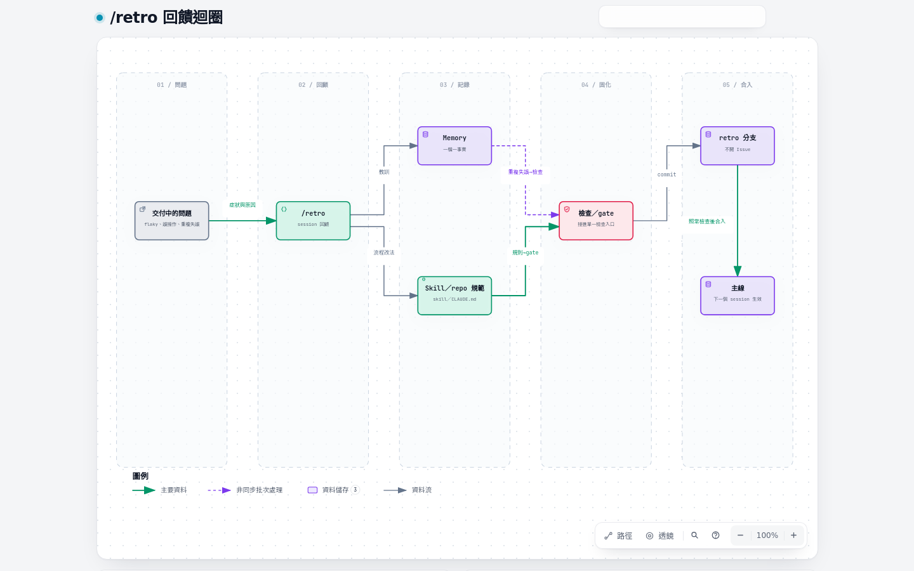

# 07 規則沉澱

agent 每個 session 都從零開始。踩過的坑要不再踩，就得寫在下一個 session 讀得到、而且擋得住的地方。本章講規則放哪一層、什麼時候往下一層升級。

## 四層

| 層 | 放在哪 | 誰讀 | 強制力 |
| --- | --- | --- | --- |
| **memory** | 個人的 `~/.claude/projects/<repo>/memory/`，一檔一個事實，`MEMORY.md` 當索引 | 只有自己在這個 repo 的 session | 無；只是提醒 |
| **skill** | 使用者層 `~/.claude/skills/`（ron-skills 同步），專案層 repo 的 `.claude/skills/` | 觸發該 skill 的 session | 照步驟跑才生效 |
| **repo 規範** | `CLAUDE.md`／`AGENTS.md`、`docs/agents/`（adapter、tracker、label）、`docs/adr/`；給 agent 讀的用英文 | 每個在這個 repo 工作的 agent | 照步驟跑才生效 |
| **腳本與 gate** | 單一檢查入口裡的檢查、入口腳本、git hooks、Claude Code hooks | 每次執行都跑 | 流程內或本地強制（見 [06 強度分級](06-quality-gates.md#強度分級)） |

原則是**寫了仍被忽略，就往下一層升級**。同一個失誤出現第二次，不再把文字寫得更用力，而是把它做成檢查或入口，失敗時印出修正指示。反過來，只有判斷題（「和周圍風格一致」「這個抽象值不值得」）才留在文字層，因為沒有檢查能代替判斷。

## 升級的例子（ron-skills）

| 失誤 | 原本的規則 | 升級成 |
| --- | --- | --- |
| 本機的 Matt fork 落後上游，overlay 補丁在上游已經套不上，本機卻一直是綠的 | README 寫「升級前先同步 fork」 | `bin/check --upstream` 對上游最新版重跑，CI 每週一跑一次 |
| `/loop` 驅動的 skill 被設成 `disable-model-invocation`，loop 叫不起來 | README 一句話 | `scripts/check-loop-invocable.mjs` 接進 `bin/sync-skills --check` |
| skill 引用了 adapter 範本裡不存在的 Pilot 設定行 | 寫 skill 時自己對照 | `scripts/check-pilot-lines.mjs` |
| 導讀站從實例專案改寫時，專案名與內網位址混進通用版 | 改寫時注意 | `scripts/check-workflow-strings.mjs` |
| skill 規範改了，導讀還是舊說法 | 改 skill 的人記得改導讀 | `scripts/check-workflow-sync.mjs`：規範一改就失敗，對照後 `--restamp` |

每一條都在 `bin/check` 裡，所以 pre-commit、CI、`/issue-run` 的 acceptance 都會跑到，不必再記得。

## 新檢查要先證明自己

一個只證明「正確的程式能通過」的檢查，沒有證明任何事。新增 lint、測試、hook 或 gate 之前：

1. **先問能不能在更上層消除它。** 先從架構、再從型別，看能不能讓這個錯誤根本寫不出來；做不到才加檢查。
2. **把真實發生過的那次錯誤做成 fixture。** 不是想像中的錯誤，是那一次的檔案、那一行字、那個 commit。
3. **附上它在 fixture 上失敗的證據**：指令與非 0 的 exit code；再附它在修好的版本上通過的指令與 exit 0。
4. **接進單一檢查入口。** 沒接進去的檢查等於不存在。

例子：ron-skills 加 `check-workflow-strings.mjs` 時，測試裡放了一份寫入專案名的 Markdown，證明守門在它上面 exit 1；同時放一份只含公開站網址的 Markdown，證明白名單放行而 exit 0。

## 誰來升級

互動版：[diagrams/07-retro-loop.html](diagrams/07-retro-loop.html)（來源 [`diagrams/src/07-retro-loop.dataflow.json`](diagrams/src/07-retro-loop.dataflow.json)）

- **`/retro`**：session 結束後輸入，它讀這次的紀錄提出改善項目（導覽、自動檢查、規範、無效規則、工具成本），依嚴重度排列。採用的項目放在 retro 分支實作，不開 Issue。
- **`/retro-collect`**（L3）：退役 coordinator 的 `/retro` 只寫檔不實作，全部收齊後由它在一個 retro worktree 一次實作（見 [05](05-level3.md#retro-collect)）。
- **你自己**：同一句指示對 agent 說第二次時，就是該升級的訊號。

## 什麼不該寫

- repo 已經記錄的事（程式結構、git 歷史、既有的 `CLAUDE.md`）不要再寫進 memory。
- 只對這次對話有用的事不要寫進任何一層。
- 不改變 agent 行為的規則（no-op）要刪掉：規則越多，每一條被讀到的機會越小。
